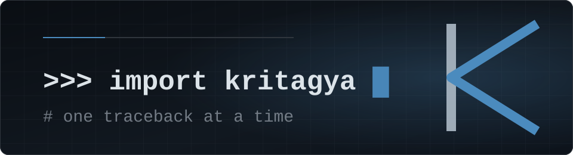

<h1 align="center">Kritagya</h1>

<p align="center"><code>python</code> · still learning · building in public</p>

<p align="center">
  I write Python — small tools that scratch an itch, experiments that teach me
  something, and the occasional thing that actually works. Mostly self-taught,
  usually a little out of my depth, and fine with that.
</p>

---

### Now

- **Building** — small Python tools, one annoyance at a time
- **Learning** — by shipping: break it, read the traceback, fix it, repeat
- **Exploring** — HTML and CSS next to Python, and Git beyond `push`/`pull`

### Selected work

- [**EzSort**](https://github.com/kritagyadubey/EzSort) — takes a messy folder and files everything into neat subfolders, from the command line or a desktop app
- [**Easy Clipboard Manager**](https://github.com/kritagyadubey/Easy-Clipboard-Manager) — a local, privacy-first clipboard history for Windows
- [**AI Prompt Vault**](https://github.com/kritagyadubey/AI-Prompt-Vault) — 162 prompt enhancers across 14 categories, MIT licensed

and the *Ez* series on the side — [EzRename](https://github.com/kritagyadubey/EzRename), [EzCleanup](https://github.com/kritagyadubey/EzCleanup) — same idea, smaller scope.

```python
# kritagya.py
status = "still learning"
tools_shipped = "a few"
```

---

<p align="center">
  <picture>
    <source media="(prefers-color-scheme: dark)" srcset="assets/monogram-dark.svg">
    
  </picture>
</p>

<p align="center">Still learning. If you're stuck on the same thing, say hi.</p>
